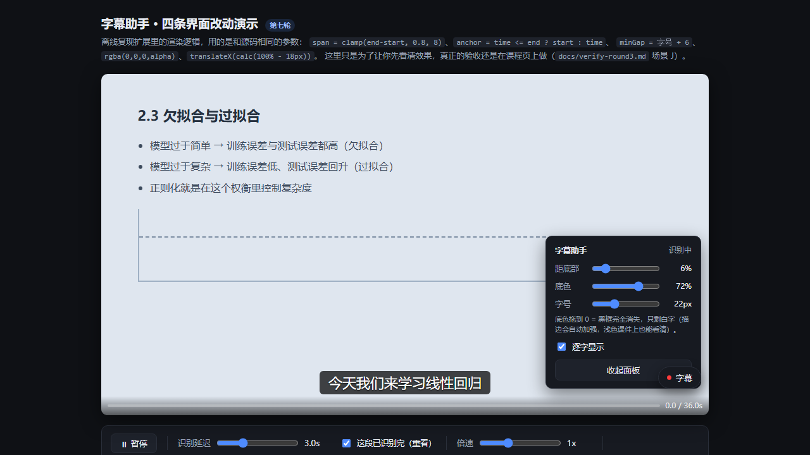

# 网络课程字幕助手

> 给**任意网页**里的教学视频实时生成中文字幕的 Chrome / Edge 扩展 —— 本地 Whisper 或云端识别，音频不出本机也能用。

[](https://github.com/repentkun929/zimu-subtitle-assistant/actions/workflows/test.yml)


网课平台没字幕、公司内部培训系统不给字幕、学校自建学习平台只放了个裸 `<video>`——
只要视频是网页里的普通播放器，这个扩展就能把它**正在播放的声音**切块送去语音识别，
把字幕实时叠在画面上，还能导出 `.srt` 存档。

**不需要麦克风、不需要下载视频、不需要字幕文件**：它读的是视频元素自己输出的音轨，
所以戴耳机、静音放、开倍速都不影响识别。



<sub>字幕叠在视频下沿，右侧面板可拖拽、可收起贴边；上图为 `demo/caption-preview.html` 的离线渲染效果，不装扩展也能看。</sub>

---

## 功能特性

| 特性 | 说明 |
| --- | --- |
| **实时中文字幕** | 边播边识别边显示，无需等待整片转写 |
| **四条识别路线** | 本地 Whisper（免费·低延迟·不外传）/ 本地中继 / 云端 API 直连 / 任意 OpenAI 兼容服务 |
| **时间轴对齐** | 每块音频的时间戳取自 `video.currentTime`，暂停、拖进度条、切集、倍速都不会错位 |
| **跨块去重** | 相邻音频块重叠 1 秒 + 文本去重，一句话被切在块边界也能补全 |
| **逐字显示** | 打字机效果，节奏跟着**这句话自己的语速**走，说完停留约 1.5 秒再换下一条 |
| **样式可调** | 字号、距底距离、底色浓度（拖到 0 完全透明只剩文字+描边）、面板可拖拽 |
| **悬浮窗收起** | 面板贴边成一条窄边，不遮挡画面；收起状态会被记住 |
| **导出 SRT** | 一键导出标准字幕文件，扔进任意播放器都能用 |
| **省流量** | 静音块跳过（不说话的部分不上传）+ 识别结果内存缓存（重看不重复计费） |
| **两套采集方式** | `captureStream()` 精准采集单个视频；采不到声音时自动降级为 `tabCapture` 抓整页 |
| **隐私** | API Key 只存在扩展后台的 service worker 里，页面脚本拿不到；本地模式下音频不离机 |

## 技术栈

**扩展端**（`src/`，约 4600 行原生 JavaScript，零第三方运行时依赖）

| 层 | 用了什么 |
| --- | --- |
| 扩展平台 | **Chrome Extension Manifest V3**，最低 Chrome / Edge **116** |
| 语言 | 原生 **JavaScript（ES2022）**：后台为 ES Module，内容脚本为无打包的 classic script（自研内联注入，见 `tools/build.mjs`） |
| 音频采集 | **Media Streams API** —— `HTMLMediaElement.captureStream()` + `MediaRecorder`；兜底 **`chrome.tabCapture` + Offscreen Documents** |
| 音频处理 | **Web Audio API**（`AudioContext` / `OfflineAudioContext`）重采样为 **16kHz 单声道**，自写 **WAV 编码器**（纯 JS，不依赖 ffmpeg / wasm） |
| 页面注入 | **Content Scripts**（`all_frames`）+ **Shadow DOM** 隔离样式 + 像素级定位（跟随 `getBoundingClientRect`，全屏/缩放/滚动都跟得住） |
| 跨域请求 | 后台 service worker 代发，**`optional_host_permissions`** 运行时按需申请域名授权 |
| 存储 | **`chrome.storage.sync` / `local`**（设置、缓存） |
| 打包 | 自研 `node tools/build.mjs`（复制 + manifest 重写 + 语法检查 + import 校验），**无 webpack / vite / rollup** |

**识别服务端**（可选，两条路任选）

| 服务 | 技术 |
| --- | --- |
| 本地识别 `tools/local-asr/server.py`（约 1000 行） | **Python 3.10+**、**faster-whisper**（CTranslate2 后端，也可回退 `openai-whisper`）、**PyAV** 解码 WAV、标准库 `http.server` 自写路由；实现**滚动解码 + LocalAgreement 定稿 + 幻觉过滤**的流式接口 |
| 本地中继 `tools/server/relay.mjs`（约 250 行） | **Node.js 20+ 零依赖**：`node:http` + 手写 multipart 解析，把请求转发到任意上游并打印完整日志 |

**协议**：OpenAI 兼容的 `/audio/transcriptions`（`multipart/form-data`）与
`/chat/completions`（`input_audio` 走 `data:` URI）两种，覆盖硅基流动、阿里云百炼、OpenAI 与各类自建网关。

**工程**：`node:test` + `node:assert`（**209 项**单测/集成测试，含起真实进程的中继端到端测试）、
服务端 `--selftest`（**27 项**）、**GitHub Actions** CI（Node 20/22 矩阵）。

## 下载

**只想用、不想碰代码**（推荐）：到 [Releases](https://github.com/repentkun929/zimu-subtitle-assistant/releases) 下载
`zimu-subtitle-assistant-v0.2.0.zip` —— 里面是**已打包好的扩展**，解压后在
`chrome://extensions` 开发者模式里选 `dist` 目录即可，不需要 Node。

**要源码 / 想改**：

```bash
git clone https://github.com/repentkun929/zimu-subtitle-assistant.git
cd zimu-subtitle-assistant
node tools/build.mjs        # 生成 dist/
```

不想用 git：点仓库右上角 **Code → Download ZIP**，解压后同样先跑一次 `node tools/build.mjs`。

**环境要求**

| 项 | 要求 |
| --- | --- |
| 浏览器 | Chrome / Edge **116 或更高**（需要 MV3 + Offscreen Documents） |
| Node.js | **20+**（只用于打包扩展和跑测试；扩展本身运行不依赖 Node） |
| Python | **3.10+**（可选，仅"路线 A 本地 Whisper"需要） |

## 快速开始（约 5 分钟）

```bash
# 1. 打包（把 src/ 编译到 dist/，同时做语法检查）
node tools/build.mjs

# 2. 浏览器地址栏打开 chrome://extensions（Edge 是 edge://extensions）
#    打开右上角「开发者模式」→「加载已解压的扩展程序」→ 选本项目的 dist 目录

# 3. （可选，推荐）本地识别：装依赖 → 自检 → 启动
pip install faster-whisper
python tools/local-asr/server.py --selftest
python tools/local-asr/server.py

# 4. 点工具栏插件图标 → 设置面板 → 选「本地 Whisper」→ 测试连接 → 保存
# 5. 打开任意带 <video> 的视频页面 → 点右下角悬浮按钮 →「开启字幕」
```

第一段字幕约 **5~7 秒**后出现（这是 Whisper 需要攒够音频才认稳的地板，不是 bug），
之后持续更新。快捷键 **`Alt + Shift + Z`** 可直接开关字幕。

完整的识别服务配置（四条路线怎么选、API Key 去哪拿、参数怎么调、哪些服务**不能**用、
成本估算、故障排查）全部在下面 👇 —— 或直接跳到 [安装与配置](#安装与配置详细)。

## 文档索引

| 文档 | 用途 |
| --- | --- |
| **本文件** | 安装、配置、使用、原理 |
| [docs/handoff.md](docs/handoff.md) | **接手开发先看这个**：现状、架构、验证方法 |
| [docs/gotchas.md](docs/gotchas.md) | 踩坑记录 —— 症状与真因都不像，改代码前必读 |
| [docs/roadmap.md](docs/roadmap.md) | 下一步该做什么 |
| [docs/troubleshooting.md](docs/troubleshooting.md) | 使用中遇到问题怎么排查 |
| [docs/verify-round3.md](docs/verify-round3.md) | 真实课程页上的验收清单 |
| [docs/model-comparison.html](docs/model-comparison.html) | 识别模型选型对照（误差率图表） |
| [demo/caption-preview.html](demo/caption-preview.html) | 字幕效果离线演示（不用装扩展就能看） |

## 当前状态

**功能已完整跑通**，并在真实课程页面上验证过。默认使用**本地 Whisper**，
识别速度实测 **3.5 倍实时**（6.6 秒语音 → 1.91 秒），总延迟约 8 秒；不花钱、音频不出本机。
测试：`npm test` → **209 项全绿**。

---

## 一分钟看懂原理

```
网页里的 <video>
   │  captureStream()  ── 直接拿到这个视频的声音，不录音、不碰麦克风
   │                      （会先剥掉视频轨，否则会把画面一起录进去）
   ▼
切成小片（流式：每 1.6 秒一片，重叠 0.4 秒；分块：每 6 秒一块，重叠 1 秒）
   │  用 video.currentTime 记录每片在视频时间轴上的真实起止时间
   ▼
转成 16kHz 单声道 WAV，base64 编码后交给扩展后台
   │  API Key 只存在后台，页面脚本拿不到
   ▼
发送到识别服务（本地 Whisper / 本地中继 / 云端）
   │  流式模式：服务端滚动解码，把「已认稳」的部分带着真实时间戳返回
   ▼
按时间轴对齐 + 跨块去重 + 按标点断句 + 补足最短显示时长
   ▼
字幕叠加层（Shadow DOM，像素定位，全屏/缩放/滚动都跟得住）
```

四个关键设计决定了它好不好用：

| 设计 | 解决的问题 |
| --- | --- |
| 时间戳取自 `video.currentTime`，而不是"录了多少秒" | 你暂停、拖进度条、切集，字幕都不会错位 |
| 相邻音频块重叠 + 文本去重 | 一句话正好被切在块边界时，下一块能把它补全 |
| 采集的是视频自身的音轨，不是麦克风 | 戴耳机、静音放、开倍速都不影响识别 |
| 字幕"保留到被下一条替换"，而不是说完就消失 | 块与块之间有间隔，否则会闪一句、空一段，很不连贯 |
| 流式模式只把服务端**已经认稳**的文字上屏 | 未定稿的文字会随新音频变化，直接显示会闪错字 |

### 两套音频采集方式

| 方式 | 抓什么 | 说明 |
| --- | --- | --- |
| **视频元素**（默认） | `video.captureStream()` 取这个视频的声音 | 精准，只含这一个视频的音频。多数播放器都能用 |
| **整个标签页**（兜底） | `chrome.tabCapture` 抓标签页正在播放的声音 | 不依赖播放器实现，兼容性最好 |

设置里可选“自动 / 只用视频元素 / 抓取整个标签页声音”。选**自动**时：先试元素方式，
若录出来的音频块是空的，插件会**自动**切换成标签页方式并重试，不需要你干预。

> 标签页方式需要保持**这个标签页在播放**；录进来的是该标签页里的所有声音（看网课无影响）。
> 页面自身的播放不受影响，你照常能听到声音。

**新增权限**：`tabCapture`、`offscreen`、`scripting`。
tabCapture 与 scripting 只在**你主动操作**（点"开启字幕"或从插件图标点"唤出面板"）时才调用，
不存在后台静默录制。

### 一个曾经很致命的坑：只录音频，不要连画面一起录

`video.captureStream()` 不带参数时会**同时返回视频轨和音频轨**。如果整个交给 `MediaRecorder`，
它会把画面也录下来：12 秒的块会从应有的约 96KB 膨胀到 1.4～3.4MB。更要命的是，语音识别服务拿到这种带视频轨的文件**解不出音轨，会返回空文本** ——
症状表现为“采集正常、上传成功、但一条字幕都没有”，极难排查。

所以代码里会先剥掉视频轨（见 `src/content/audio-source.js` 的 `audioOnlyStream`），
并有一条专门的回归测试守着它。**判断是否正常：12 秒的块应该在 100KB 上下。**

---

## 安装与配置（详细）

### 第 1 步：选一个识别服务

插件需要有地方做语音识别。四条路，**推荐路线 A**：

| 路线 | 延迟 | 费用 | 需要联网 | 适合谁 |
| --- | --- | --- | --- | --- |
| **A. 本地 Whisper**（推荐） | **首次字幕约 5~7 秒** | 免费 | 首次下载模型后不需要 | 想低延迟、不花钱、在意隐私 |
| B. 本地中继 → 云端 | 实测约 12~18 秒 | 按量计费 | 需要 | 不想在浏览器存 Key |
| C. 直接填云端 API | 实测约 12~18 秒 | 按量计费 | 需要 | 不想多开进程 |
| D. 其他 OpenAI 兼容服务 | 视服务而定 | 视服务而定 | 需要 | 已有自建网关 |

> **为什么差这么多**：云端接口每次都要排队 + 网络往返，实测稳定在 8~15 秒；
> 本地模型省掉这两项，只需要算力时间。这是架构差异，不是调参能突破的。
>
> **关于为什么是 5 秒而不是 1 秒**：字幕要等 Whisper 把一段话「认稳」了才敢上屏。
> 实测攒够约 5 秒音频输出才稳定（2 秒时模型会给出错词），这是模型属性，
> 改架构、调参数都突破不了。**想要几乎同步，只能提前把整片转写好**
> （见 `docs/roadmap.md` 的 P0.5，需要视频能整段下载）。
>
> **实测数据**（AMD Ryzen 7 7735H，8 核，small 模型）：6.6 秒语音识别耗时 **1.91 秒**，
> 即 **3.5 倍实时速度**。识别准确度示例：
> 原文「今天我们来学习线性回归，首先看一下这个数据集的特点。」
> 识别「今天我们来学习线性回归,首先看一下这个数据机的特点。」

---

### 路线 A：本地 Whisper（推荐）

模型跑在你自己电脑上。延迟低、不花钱、不联网也能用。

**A1. 装依赖**（只需一次，约 250MB）

```powershell
pip install faster-whisper
```

如果下载慢或失败，换国内镜像：

```powershell
pip install faster-whisper -i https://mirrors.aliyun.com/pypi/simple/
```

**A2. 先自检**（不下载模型，几秒出结果，用来确认环境没问题）

```powershell
python tools\local-asr\server.py --selftest
```

看到「自检全部通过」就可以了。它会检查 WAV 读写、请求解析、文本清洗，并告诉你有没有装 Whisper 后端。

**A3. 启动服务**（首次会下载模型，约 460MB，耐心等一次）

```powershell
python tools\local-asr\server.py
```

模型会自动下载到 `C:\Users\<你>\.cache\zimu-whisper`，之后启动就是秒开。

> **下载源已自动指向国内镜像**（`hf-mirror.com`）：`huggingface.co` 在国内基本连不上，
> 而模型必须从那里下载。镜像站内容完全一致。如果镜像也不通，可以手动指定：
> `python tools\local-asr\server.py --hf-endpoint https://hf-mirror.com`

看到这些就成功了：

```
[本地识别] 模型下载源：https://hf-mirror.com
[本地识别] 已接管音频解码（av 19.0.1）…
[本地识别] 加载完成，耗时 150.7s，后端 faster-whisper
[本地识别] 服务已启动：http://127.0.0.1:8788/v1
```

**A4. 验证真的能识别**（推荐做一次，比"进程活着"有说服力）

```powershell
python tools\local-asr\probe.py
```

它会做三件事：健康检查、发一段音频、以及**静音测试**
（验证服务不会在无声处编出假字幕——Whisper 有这个毛病）。

想看真实识别效果：

```powershell
python tools\local-asr\verify-speech.py
```

它用 Windows 自带语音合成读一句中文，再送去识别并比对关键词。

**A5. 扩展里选「本地 Whisper」**（设置面板第一个选项，地址已自动填好）
**API Key 留空**，模型名保持默认即可（本地服务会忽略它）。

**常用参数**（在启动命令后面加）：

| 参数 | 作用 | 建议 |
| --- | --- | --- |
| `--model` | 模型大小：`tiny`/`base`/`small`/`medium`/`large-v3` | 默认 `small`；中文想更准用 `medium`（更慢更吃内存） |
| `--compute-type` | `int8` / `float32` | 默认 `int8`，省内存 |
| `--beam-size` | `1` 最快，调大更准但更慢 | 默认 `1` |
| `--language` | 默认 `zh`；填 `auto` 自动判断 | 中文课保持 `zh` |

例如想更准确：

```powershell
python tools\local-asr\server.py --model medium --beam-size 3
```

> **注意内存**：`small` 约占 1GB，`medium` 约占 2.5GB，`large-v3` 约 4GB。
> 先看清自己机器还剩多少可用内存再选。

---

### 路线 B：本地中继（转发到云端服务）

优点是不用在浏览器里存 API Key，还能在终端里看到完整的请求日志，好排查。

```powershell
# 1. 在本项目目录下复制配置模板
Copy-Item tools\server\relay.config.example.json tools\server\relay.config.json

# 2. 编辑 relay.config.json，填入上游服务信息（下面有怎么拿 Key）
#    upstream: https://api.siliconflow.cn/v1
#    apiKey:   sk-你的Key
#    model:    FunAudioLLM/SenseVoiceSmall

# 3. 启动中继服务（保持这个窗口开着）
node tools/server/relay.mjs
```

看到 `监听地址：http://127.0.0.1:8787/v1` 就是成功了。

### 路线 C：直接填云端 API（**推荐，本机零负担**）

不想多开进程、也不想让模型占自己电脑的 CPU 就用这条。设置面板里直接选预设即可。

| 预设 | 模型 | 说明 |
| --- | --- | --- |
| **硅基流动 · Qwen3-ASR-1.7B** ★首推 | `Qwen/Qwen3-ASR-1.7B` | 中文最准的一档，硅基流动标价**免费** |
| 硅基流动 · 星辰 V3.2-Ultra | `XingChenAGI/XingChenASR-V3.2-Ultra` | 60 种方言，但会对口语做“可读性规整”，**不够逐字忠实** |
| 阿里云百炼 · qwen3-asr-flash | `qwen3-asr-flash` | 与 Qwen3-ASR 同源，新账号送 10 小时 |
| 硅基流动 · SenseVoiceSmall | `FunAudioLLM/SenseVoiceSmall` | 免费，但只有 234M、不利用上下文，**错字明显更多** |

首推[硅基流动](https://cloud.siliconflow.cn/)：注册后在控制台创建 API Key，选
「硅基流动 · Qwen3-ASR-1.7B」即可。

**为什么推荐换掉 SenseVoiceSmall**：它的中文 CER 约 3.0%，
而 Qwen3-ASR-1.7B 约 1.58%（**错字差不多减半**）；
在会议、带口音、有背景音的课堂素材上差距更大。
完整的选型对照（误差率图表 + 逐条点评）见 [`docs/model-comparison.html`](docs/model-comparison.html)，
实测数据见 `docs/gotchas.md` #35。

如果你有 OpenAI Key 且网络能通，也可以选 OpenAI 官方，模型 `whisper-1`。

### 路线 D：任何 OpenAI 兼容服务

自建网关、Azure OpenAI、one-api / new-api 中转站都可以。

插件支持**两种调用协议**，在设置里选：

- `/audio/transcriptions` —— `multipart/form-data`，传 `file` 与 `model` 两个字段（最通用）；
- `/chat/completions` —— 音频以 `data:` URI 放进 `messages[].content[].input_audio.data`
  （阿里云百炼的 `qwen3-asr-flash`、以及“生成式 ASR”类模型走这条）。

设置面板会把**实际请求地址**显示出来，选错协议一眼就能看见。

### ⚠️ 哪些 AI 服务**不能**用

这是最容易踩的坑：**只有文本大模型的服务商做不了字幕识别**，因为它们的 API 里
根本没有音频转录接口，模型也不具备听音频的能力。插件会提前拦住并给出提示，但最好一开始就别选。

| 服务商 | 能不能用 | 原因 |
| --- | --- | --- |
| DeepSeek（api.deepseek.com） | ❌ 不能 | 接口只有对话、视觉、文件；模型是纯文本模型，没有语音识别能力 |
| Moonshot / Kimi | ❌ 不能 | 同上，只有文本大模型接口 |
| 智谱 open.bigmodel.cn | ❌ 不能 | 这是大模型接口；智谱另有**独立的**语音识别服务，地址和协议都不同，不能填这里 |
| 硅基流动 SiliconFlow | ✅ 能 | `Qwen/Qwen3-ASR-1.7B`、`XingChenASR-V3.2-Ultra`、`SenseVoiceSmall` 等 |
| 阿里云百炼 | ✅ 能 | `qwen3-asr-flash`、`fun-asr`（走 `/chat/completions`） |
| OpenAI | ✅ 能 | `whisper-1` 等 |
| 本地中继（本项目自带） | ✅ 能 | 上游接任意语音识别服务 |
| 任何 OpenAI 兼容的语音识别网关 | ✅ 能 | 路由到 `/audio/transcriptions` 或 `/chat/completions` 即可 |

一句话判断标准：**去服务商的 API 文档里搜 `audio/transcriptions`，
搜不到就再看有没有 `chat/completions` 收 `input_audio`；两个都没有就不能用。**

如果你已经有 DeepSeek 的 Key 和账号，说明你已经熟悉"注册 → 控制台建 Key → 填入"这套流程，
换成硅基流动是同样的操作，只是多注册一个平台而已。

### 第 2 步：打包并加载扩展

```powershell
# 在项目目录下执行
node tools/build.mjs
```

然后在浏览器里：

1. 地址栏打开 `chrome://extensions`（Edge 是 `edge://extensions`）
2. 打开右上角的 **开发者模式**
3. 点 **加载已解压的扩展程序**
4. 选择本项目的 **`dist`** 目录（不是项目根目录）

### 第 3 步：配置并试跑

1. 点浏览器工具栏里的插件图标，打开设置面板
2. **供应商**：选了路线 A 就选"本地中继"，路线 B/C 就选对应项或"自定义"
3. 填好**接口地址**、**模型**、**API Key**（本地中继不需要 Key）
4. 点 **测试连接**，看到"连接成功"再往下走
5. 点 **保存设置**
6. 打开一个正在播放的教学视频页面，点右下角的**悬浮按钮** → **开启字幕**

第一段字幕大约需要 **5～7 秒**出现（这是识别模型本身的地板，不是分块秒数能解决的：
它需要攒够约 5 秒音频才能把一段话认稳）。之后字幕会持续更新。

> 快捷键：`Alt + Shift + Z` 可以直接开关字幕，不用去点悬浮按钮。

---

## 验证一切正常

项目自带一个测试页，能一键区分"插件没工作"和"视频采不到声音"这两类完全不同的问题：

```powershell
# 用浏览器打开
test/demo-video.html
```

点页面上的 **运行环境自检**，它会逐项检查浏览器能力、扩展是否注入、以及**实际录音后的音量**。
如果音量显示"几乎无声"，说明问题出在视频的跨域限制上，而不是识别服务。

只想看**字幕长什么样**（逐字、底色、位置、悬浮窗收起），不用装扩展、也不涉及识别服务：

```powershell
# 用浏览器打开
demo/caption-preview.html
```

它用和源码相同的参数离线复现了渲染逻辑，一打开就在播。注意它只是"看效果"用的，
真正的验收还是在课程页上做（见 `docs/verify-round3.md` 场景 J）。

---

## 常用设置

| 设置 | 说明 | 建议值 |
| --- | --- | --- |
| **流式识别** | 小切片连续投喂、服务端边解码边定稿。**输出更连续、时间戳更准**；只对本机识别服务生效 | 开启（默认） |
| **流式切片** | 流式模式下每片多少秒音频。越小更新越频繁、越费 CPU | 1.6 秒（默认），机器吃力就调到 2~3 |
| 分块秒数 | 关掉流式后生效：每多少秒音频送一次识别。**直接决定字幕延迟** | 6 秒（默认），觉得跟不上就调到 4–5 |
| 字幕字号 / 距底部 | 字幕的显示样式，也可以直接在页面上的控制面板里拖 | 按视频清晰度调 |
| **逐字显示** | 一句话一个字一个字地冒出来（打字机效果）。节奏跟着**这句话自己的语速**走：6 秒说完的句子就花 6 秒打完，说完停留约 1.5 秒后消失，接着打下一句 | 开启（默认） |
| **底色浓度** | 字幕背后那块黑底的浓度。拖到 **0 就是完全透明**，只剩文字本身（自动加描边阴影，浅色课件上也看得清） | 72%（默认），嫌黑框丑就往低调 |
| **悬浮窗收起** | 面板滑到视频侧边、只留一条窄边，点它展开——和游戏助手一样。字幕与悬浮窗互相遮盖时用这个 | 按需 |
| 按标点拆分长句 | 把一长段话拆成多条短字幕 | 开启 |
| 缓存识别结果 | 重看同一段不重复计费（缓存在内存里，关浏览器即失效） | 开启 |
| 输出调试日志 | 在页面控制台打印每块的识别情况和耗时 | 排错时开 |

> 面板上还有一个「收起」按钮，随手就能把悬浮窗贴边；
> 收起/展开的状态会被记住，下次打开还是这个样子。

### 关于字幕延迟

字幕**必然**会比语音慢一些，因为要等音频攒够、并把一段话「认稳」才敢上屏。延迟大致是：

```
延迟 ≈ 音频攒够的时间 + 识别耗时
```

- **流式模式**（默认）：首次字幕约 **5~7 秒**，之后**持续小步更新**
- **分块模式**：约 **8~11 秒**（分块 6 秒）

两条路的地板接近，因为都受制于同一件事：**Whisper 要攒够约 5 秒音频，输出才稳定**
（实测：缓冲 2 秒时模型会把「数据集」认成「现象」）。流式的优势是**过程连续**、
**时间戳准确**，而不是首次字幕更早。

Console 里会打印真实数据，方便判断慢在哪：

```
[字幕助手] 第 3 块识别耗时 2.4s，视频进度 341.2s（该块覆盖 328.2s→340.2s，落后约 1.0s）
[字幕助手] 第 N 片定稿 2 条：……（解码 380ms，视频 341.2s）｜未定稿：……
```

**如果"落后"经常超过 10 秒**：流式模式下把**流式切片**调小（1.6 → 1.0）；
分块模式下把**分块秒数**调小（6 → 4）。代价都是请求变密、CPU 占用上升。

**想要「几乎同步」**：那需要**提前把整片音频转写好**再播放，实时链路做不到。
可行性探测工具见 `tools/prefetch-probe.js`，方案见 `docs/roadmap.md` 的 P0.5。

---

## 成本大概多少

按 `chunkSeconds = 12`、重叠 1 秒计算：**1 小时视频约需上传 327 分钟音频**（因为重叠会多约 8%），
产生约 328 次请求。

以硅基流动为例，价格极低甚至免费（`Qwen/Qwen3-ASR-1.7B`、`SenseVoiceSmall`
在其价格页标注为免费）；阿里云百炼 `qwen3-asr-flash` 新账号送 10 小时。
OpenAI `whisper-1` 按分钟计费，一小时约 0.36 美元。实际花费请以你的服务商价目为准。

省钱的三个开关：调大**分块秒数**、保持**静音块跳过**（插件默认已开，不说话的部分不会上传）、
保持**缓存**开启。

---

## 遇到问题

请看 [docs/troubleshooting.md](docs/troubleshooting.md)，里面按现象分类列了排查步骤。
最常见的两个：

- **一直不出字幕**：多半是视频来自另一个域名且没开放跨域，浏览器不允许读取它的声音。
  用测试页的"环境自检"确认，这种情况属于浏览器安全限制，换视频源才能解决。
- **字幕内容不对/重复**：开"输出调试日志"，看每块识别出了什么。
  如果日志里每块只有 1~2 秒（而不是你设的分块秒数），说明正卡在
  「流式降级没回滚采集窗口」这个已修的缺陷上（`docs/gotchas.md` #34），
  重新打包刷新即可。错字本身偏多则建议换「硅基流动 · Qwen3-ASR-1.7B」。

---

## 项目结构

```
src/                      源码（改这里，不要改 dist）
  manifest.json           MV3 清单
  common/
    settings.js           默认设置、供应商预设、调用协议（transcriptions/chat）、权限匹配
    transcript.js         字幕文本处理：清洗/去重/断句/导出 SRT（纯函数，有完整单测）
    asr-client.js          识别服务调用（OpenAI 兼容：multipart 或 chat 两种协议）
  content/
    capture.js            音频采集与切片（按媒体时间计时）
    audio-source.js       采集源选择：视频元素 / 整个标签页，含自动降级
    overlay.js            字幕叠加层与页面内控制面板
    subtitles.js          主控：探测视频、启停、渲染同步、流式投喂
  background/
    service-worker.js     保管密钥、发起跨域请求、按需申请域名授权
  popup/                  设置面板（HTML + CSS + JS）
tools/
  build.mjs               打包：src → dist，并做语法检查
  check-modules.mjs       ES module 语法检查（子进程）
  server/relay.mjs        本地中继服务（零依赖）
  local-asr/server.py     本地 Whisper 识别服务（含流式接口）
  local-asr/probe.py      连通性 + 静音幻觉检查
  local-asr/verify-speech.py 真实语音测速（判断是服务慢还是页面抢 CPU）
  prefetch-probe.js       预转写可行性探测（整段粘进页面 Console 执行）
  sim-timeline.mjs        渲染节奏推演（按真实节奏打印屏幕上出现过的字幕，排错用）
demo/
  caption-preview.html    界面效果离线演示（逐字/底色/位置/收起四条，不用装扩展就能看）
docs/                     交接、踩坑、路线图、排查、验收清单、模型选型对照
docs/images/              界面截图（README 用）
test/                     15 个 .test.mjs（209 项），节选：
  transcript.test.mjs     字幕算法单测（清洗/去重/断句/SRT）
  asr-protocol.test.mjs   两种调用协议、端点拼接、供应商预设完整性
  streaming-fallback.test.mjs  流式该不该开、降级回滚采集窗口
  relay.test.mjs          中继服务端到端测试（起真实进程，端口动态分配）
  content-scripts.test.mjs 内容脚本加载冒烟测试
  recorder-options.test.mjs 采集参数与环境探测
  demo-video.html         浏览器里的环境自检页
.github/workflows/test.yml  CI：Node 20/22 矩阵 → 打包 + 209 项测试 + 服务端自检
LICENSE                   MIT
```

### 开发命令

```powershell
node tools/build.mjs     # 打包到 dist（含语法检查）
node --test "test/**/*.test.mjs"   # 跑全部测试（209 项）
node tools/server/relay.mjs        # 启动本地中继
```

改完 `src/` 下的代码后要重新执行 `node tools/build.mjs`，然后在 `chrome://extensions`
里点一下扩展的**刷新**按钮，再刷新视频页面。

---

## 设计取舍与已知限制

- **本地 Whisper 和云端都能用**：默认走本地 Whisper（音频不出本机，也吃 CPU/内存），
  也保留了云端 API 那条路（路线 B/C/D，本机零负担）。两条路只在
  `src/common/asr-client.js` 一处分叉，区别只有“谁来解码音频”——
  本地服务只解 WAV，所以扩展侧会先把音频转成 16kHz 单声道 WAV。
- **流式识别只对本机服务开**：云端没有 `/audio/stream`，而且流式会把未定稿音频
  反复解码、等于反复计费。所以采集窗口的长度必须**在开始录音前**就按服务位置定下来
  （`shouldUseStreaming()`）；万一中途降级，也必须把窗口改回 `chunkSeconds`
  （`fallBackToChunkMode()`）。**只改标志位不改窗口，就会每 1.6 秒把一句话切断送识别**
  ——这是用户实测里“错字漏字”的真因，见 `docs/gotchas.md` #34。
- **为什么靠分块而不是服务端时间戳**：国内多家服务的转录接口只返回纯文本、不返回时间戳
  （例如硅基流动）。用"按视频时间轴分块"的方式，任何只返回文本的服务都能用，
  兼容性最大化。代价是块内的句子时间按字数比例分配，是估算值。
- **跨域视频采不到声音**：这是浏览器的同源策略限制，不是插件缺陷。视频服务器需要返回
  `Access-Control-Allow-Origin`。公司内部平台如果由你方维护，让运维加上这个响应头即可。
  若无法改动平台，用“抓取整个标签页声音”可以绕开（它不经过页面读取音频）。
- **DRM 加密视频不支持**：受保护的内容浏览器不允许任何脚本读取其音轨。
- **只能采集 `<video>` 元素**：如果平台用了非常规播放器（例如自己实现的 Canvas 渲染），
  需要额外适配。
- **暂停时不切块**：暂停期间不再产生新块（没声音、省请求），恢复播放后自动继续。

---

## 参与与许可

- 遇到问题先看 [docs/troubleshooting.md](docs/troubleshooting.md) 与 [docs/gotchas.md](docs/gotchas.md)（40 条踩坑记录，症状和真因经常对不上）。
- 改代码前请先读 [docs/handoff.md](docs/handoff.md)，跑通 `node tools/build.mjs && node --test "test/**/*.test.mjs"` 再提交。
- 提交 issue 时请附上：浏览器版本、识别路线（A/B/C/D）、Console 里 `[字幕助手]` 开头的日志。
- 本项目以 [MIT License](LICENSE) 发布。
- CI：[`.github/workflows/test.yml`](.github/workflows/test.yml) 在 Node 20 / 22 上跑「打包 + 全量测试 + 服务端自检」，提交即触发。
