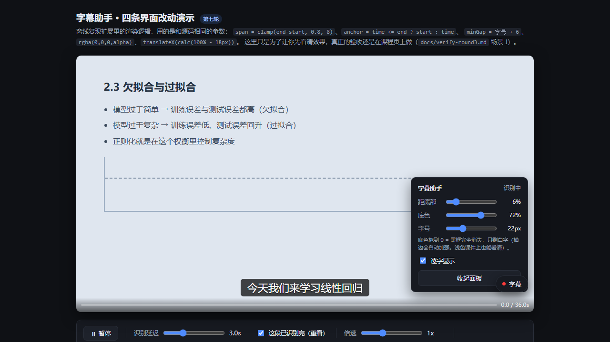

## 网络课程字幕助手 v0.2.0

给任意网页里的教学视频实时加中文字幕的 Chrome / Edge 扩展。首个公开版本。

### 这个包里是什么

`zimu-subtitle-assistant-v0.2.0.zip` 是**已经打包好的扩展**（18 个文件，含 `manifest.json`）。
解压后按下面三步就能加载，不需要装 Node、不需要构建。

### 安装（1 分钟，不含识别服务）

1. 解压 zip，得到 `dist/` 目录
2. 浏览器打开 `chrome://extensions`（Edge 用 `edge://extensions`），打开右上角**开发者模式**
3. 点**加载已解压的扩展程序**，选中解压出来的 **`dist`** 目录

扩展图标出现在工具栏即可。点它打开设置面板。

### 配置识别服务（三种选法）

| 方式 | 适合谁 | 怎么做 |
| --- | --- | --- |
| **云端 API（最简单）** | 不想装 Python | 注册 [硅基流动](https://cloud.siliconflow.cn/) → 建 API Key → 面板里选「硅基流动 · Qwen3-ASR-1.7B」→ 粘贴 Key → 测试连接 |
| **本地 Whisper（免费、不外传）** | 愿意装 Python | `pip install faster-whisper` → `python tools/local-asr/server.py` → 面板选「本地 Whisper」，Key 留空（需要完整源码，见仓库） |
| **本地中继** | 不想在浏览器里存 Key | `node tools/server/relay.mjs`，配置见仓库 `tools/server/relay.config.example.json` |

> ⚠️ DeepSeek、Moonshot、智谱的大模型接口**不能**用来做字幕——它们没有音频转录能力。判断标准：API 文档里能不能搜到 `audio/transcriptions`，或者 `chat/completions` 是否收 `input_audio`。

### 使用

打开任意带 `<video>` 的视频页面 → 点右下角**悬浮按钮** → **开启字幕**。
第一段字幕约 **5~7 秒**后出现（Whisper 要攒够约 5 秒音频才认稳，这是模型属性）。
快捷键 **`Alt + Shift + Z`** 直接开关。

### 想改代码

要源码请下载仓库的 Source code，然后 `node tools/build.mjs` 重新打包。

### 已知限制

- 跨域视频采不到声音（浏览器同源策略），可用设置里的「抓取整个标签页」绕开
- DRM 加密视频不支持
- 只支持普通 `<video>` 元素，Canvas 自绘播放器需要额外适配

---

完整文档：[README](https://github.com/repentkun929/zimu-subtitle-assistant#readme) ·
[踩坑记录](https://github.com/repentkun929/zimu-subtitle-assistant/blob/main/docs/gotchas.md) ·
[故障排查](https://github.com/repentkun929/zimu-subtitle-assistant/blob/main/docs/troubleshooting.md)
